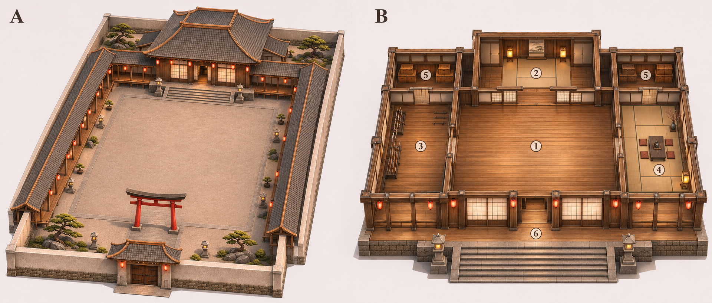

# 日式最終戰場：完整外觀與主道場剖視草案

日期：2026-11-08。內建 imagegen 概念設計，尚未建立 Unity 建築或 Tripo 模型。

## 上一張圖包含什麼

原本的 courtyard-layout-concept-v1.png 是整個院落的外觀構圖，已包含後方主道場、兩側有頂迴廊、入口、圍牆與戰鬥庭院，但沒有展開道場室內與房屋深度。兩側長屋頂的預設用途是通行迴廊，不是一整排房間。原圖不能當作完整的建築平面圖。

## 這次補出的完整規劃

- A：整個院落的斜上方外觀，展示主道場屋頂深度、左右附室屋頂、迴廊和入口的空間關係。
- B：同一主道場移除屋頂的室內剖視。為方便閱讀，這一部分放大顯示，不能與 A 用相同比例量測。

| 圖上編號 | 提議用途 | 配置 |
| --- | --- | --- |
| 1 | 中央主道場大廳 | 木地板大空間，中央保持淨空，面向庭院 |
| 2 | 後方主室 | 以拉門接中央大廳，可依劇情當 Boss 等候室或內殿；此處不實作出場邏輯 |
| 3 | 左側練武／武器室 | 武器架靠牆，留下通行與活動空間 |
| 4 | 右側茶室／休息室 | 榻榻米、矮桌與坐墊，與戰鬥空間分開 |
| 5 | 左右後側收納室 | 收納箱與裝備雜物，獨立房間 |
| 6 | 前緣木廊與階梯 | 連接主道場入口與戶外庭院 |

上述用途是這次新增的設計提案，不代表原參考資產本來就有這些房間，也不代表遊戲中已可進入或互動。此版先讓使用者看到完整外殼、房間與通道，再決定建模範圍。後室及附室的突出量、通道寬度與既有暫定 40×18 公尺主建築占地，需要在白盒階段統一檢查。

## 保留的場地原則

主決戰區仍是戶外大庭院；中央保持平坦露天。新增房間放在後方主建築內，不把建築塞進中央淨空區。保留深木構、白障子門、灰瓦、紅燈籠與紅鳥居。圍牆、迴廊和主道場分件，日後便於重用與碰撞設定。

這張雙視圖是整體設計說明圖。後續送入 Tripo 時仍要準備單一建築或模組的乾淨參考，不把 A/B 兩個比例不同的視圖當成同一物件的 Multi-view 輸入。

完整生成提示：COMPLETE_BUILDING_IMAGE_PROMPT.txt。
