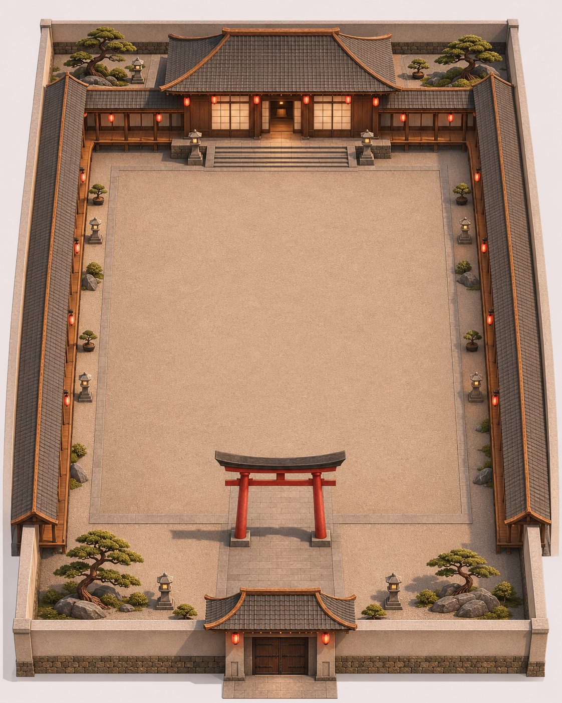

# 最終決戰日式庭院：第一步布局草案

2026-11-08 補充：[完整院落外觀與主道場室內剖視](COMPLETE_BUILDING_BRIEF.md)。本頁原俯視圖著重外部布局；新增圖展開主道場大廳、後室、左右附室、收納室與前廊，供先確認整棟建築設計。

日期：2026-11-06。狀態：構圖草案，尚未確認尺寸，也尚未建立 Unity 場景或送進 Tripo 生成模型。

## 本步要決定什麼

以戶外庭院作為主要 Boss 戰空間。上方主道場建立視覺焦點，下方入口與鳥居建立進場軸線，左右有頂迴廊圍合空間。擴大庭院與建築間距，維持門、階梯、燈籠與人物的正常尺度。

這張圖用於確認空間關係與風格；AI 生成影像不是依公尺精確繪製的施工平面，不能直接用像素量測尺寸。以下數值是後續 Unity 白盒的建議起點，需用玩家速度、Boss 招式距離與鏡頭測試後調整。參考圖沒有已知尺寸，因此不宣稱此草案是原場景的精確兩倍。

## 建議白盒尺寸

| 區域 | 初始目標 | 用途 |
| --- | --- | --- |
| 整體用地 | 寬 80 × 深 100 公尺 | 含圍牆、道場、入口、迴廊及外圈庭園 |
| 中央淨空戰鬥區 | 52 × 52 公尺 | 平坦、露天，保留翻滾、突進及讀招空間 |
| 主道場本體 | 約寬 40 × 深 18 公尺 | 後方主景，實際高度依門與人物尺度另定 |
| 外圈帶 | 依建築占地調整 | 擺放少量庭石、松樹、盆栽與石燈籠 |

若採入口為原點、+Z 指向道場、X 向左右的臨時白盒坐標，可先用：

- 整體界線：X=-40～40，Z=0～100。
- 中央淨空區：X=-26～26，Z=20～72。
- 主道場本體：X=-20～20，Z=78～96；階梯置於南側，不侵入淨空區。
- 左右迴廊：中心約 X=±33，寬度約 8 公尺，長度隨連接處調整；連接道場的後側廊道要避開階梯。
- 玩家進場參考點：(0, 地面高度, 26)；Boss 起始參考點：(0, 地面高度, 62)。這兩點只供擺位與鏡頭預覽，並非修改既有生成點。
- 鳥居與南門放在 Z<20 的入口區，避免柱子侵入戰鬥淨空。

## 圖上的閱讀順序

1. 下方：屋頂門樓與紅鳥居，玩家由此進入。
2. 中央：大片平整庭院，主戰場。
3. 上方：抬高的道場平台、寬階梯與主道場。
4. 左右：有頂迴廊與外圈裝飾，作為場地邊界及背景。

保留灰瓦、深色木構、白色障子門、紅燈籠與鳥居。庭石、樹木和石燈籠集中在外圈，中央不擺家具、凸起踏石或柱子。地面紋理可以有細節，角色碰撞地面保持可靠平整。

若最終戰沿用法像與浮空石塊階段，中央上空維持開放；需另做該階段的邊界、視線與建築碰撞驗證，不因概念圖而改寫隊友的戰場系統。

## 下一步

布局方向確認後，先製作後方「主道場」的獨立乾淨參考圖，再依序拆鳥居、迴廊、圍牆與石燈籠。整張布局圖是組裝參考；Tripo 建模輸入將以獨立物件為主。

生成方式：內建 imagegen。三張使用者提供的參考圖分別提供木構/紙門材質、圍合庭院關係、鳥居與門牆風格。產出的概念圖已複製到本資料夾。完整概念圖生成提示保存在 CONCEPT_IMAGE_PROMPT.txt，這份提示供概念圖生成使用。
