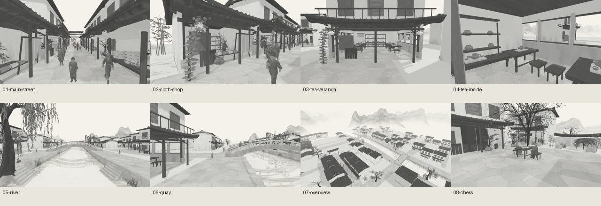

# 河鎮 V3 實際畫面

以下是 Unity 畫面；概念圖與生成材質不作成果截圖。固定檢查相機為 1920×1080、60 FOV，遊玩錄影來自原生 Game View。

| 視角 | 原始畫面 |
|---|---|
| 主街 | [01-main-street.png](captures/01-main-street.png) |
| 布店近景 | [02-cloth-shop.png](captures/02-cloth-shop.png) |
| 茶館外廊 | [03-tea-veranda.png](captures/03-tea-veranda.png) |
| 茶館室內 | [04-tea-inside.png](captures/04-tea-inside.png) |
| 河中央 | [05-river.png](captures/05-river.png) |
| 河岸 | [06-quay.png](captures/06-quay.png) |
| 俯視 | [07-overview.png](captures/07-overview.png) |
| 棋院 | [08-chess.png](captures/08-chess.png) |
| 原生遊玩／戰鬥 | [09-boss-game-view.png](focused/09-boss-game-view.png) |

[約兩分鐘連續遊玩影片](gameplay/town-continuous-combat.mp4)：雙向跨橋、主街、河岸、茶館、巷弄，實際同一 Boss 追逐與施法，並含人物穿透與回復。腳本使用既有 AI 輸入控制玩家走路，不是人工鍵盤實玩錄影；影片沒有錄音。

[詳細交付與驗收](../../../Docs/INKBOUND_TOWN_V3.md) · [52 張參考逐張比較](../../../Docs/INKBOUND_TOWN_V3_REFERENCE_REVIEW.md)

檢查原始資料：`required-checks.json`、`gameplay/checks.json`、`focused/checks.json`、`journey/checks.json`、`runtime-idle.json`、`runtime-combat.json`。`transparent-overdraw.png` 為 URP 透明填色工作視圖，非正常遊戲畫面。`baseline/` 是既有前版畫面的縮圖與來源紀錄，沒有歷史效能數據。
